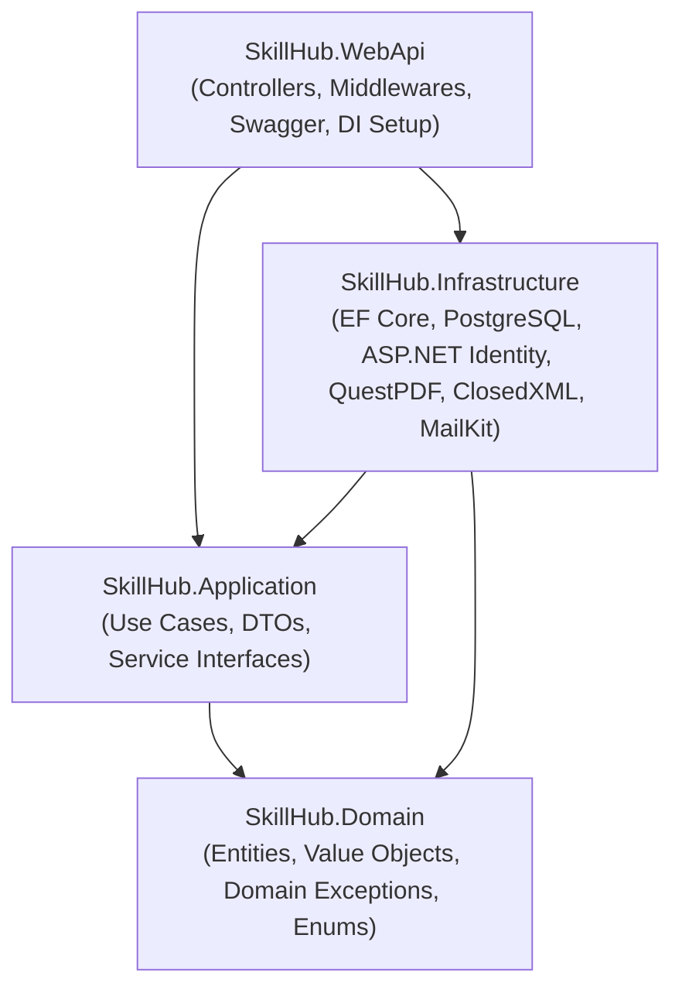

# SkillHub — In-Person Workshop & Enrollment Management API

[](https://dotnet.microsoft.com/)
[](https://learn.microsoft.com/dotnet/csharp/)
[](https://www.postgresql.org/)
[](https://learn.microsoft.com/ef/)
[](#-architecture--layers)

**SkillHub** is an enterprise-grade RESTful API for training centers that conduct short, in-person workshops across creative and professional disciplines (Photography, Culinary Arts, Public Speaking, Graphic Design, Music, etc.).

The system solves critical training logistics challenges—such as **overbooking**, **duplicate enrollments**, and **time-slot overlaps**—through a rich **Domain-Driven Design (DDD)** model implemented under **Clean Architecture** principles in **.NET 10** with **PostgreSQL** and **ASP.NET Core Identity**.

---

## Table of Contents

- [Key Features](#-key-features)
- [Architecture & Layers](#-architecture--layers)
- [Enforced Business Rules](#-enforced-business-rules)
- [Pre-Seeded Accounts & Test Data](#-pre-seeded-accounts--test-data)
  - [Instructors (Employees)](#1-instructors-employee-role)
  - [Workshops & Capacity Status](#2-workshops--capacity-status)
  - [Students (Participants)](#3-students-participant-role)
- [API Reference](#-api-reference)
- [Getting Started](#-getting-started)
  - [Prerequisites](#prerequisites)
  - [Configuration](#configuration)
  - [Running the Application](#running-the-application)
  - [Swagger UI](#swagger-ui)
- [Bulk Excel Enrollment Specification](#-bulk-excel-enrollment-specification)
- [PDF Certificate Generation](#-pdf-certificate-generation)
- [Error Handling & Responses](#-error-handling--responses)

---

## 🌟 Key Features

- **Strict Capacity Control:** Real-time occupancy tracking ensuring workshops never exceed their hard maximum capacity.
- **Schedule Overlap Detection:** Participants cannot enroll in multiple workshops with conflicting dates and hours.
- **Granular Cancellation Policies:** Automated 24-hour advance window validation for participants, with audit trails (`CancelledByUserId`, `CancelledAt`).
- **Flexible Re-Enrollment:** Participants who previously cancelled an enrollment can re-register if spots are still available.
- **Bulk Excel Ingestion:** High-performance onboarding via ClosedXML supporting partial success with granular rejection reporting per row.
- **Dynamic PDF Certificates:** Instant branded PDF certification generation using QuestPDF with enrollment metadata.
- **Enterprise Identity & JWT:** ASP.NET Core Identity integrated with Table-Per-Hierarchy (TPH) user entities and secure JSON Web Tokens.
- **6-Digit Password Recovery:** Multi-factor password reset workflow (Code generation -> Secure Email dispatch via SMTP -> Code verification -> Password update).
- **Automated & Idempotent Seeder:** Pre-populates roles, instructors, workshops, and students on initial boot.

---

## 🏗️ Architecture & Layers

The solution strictly adheres to **Clean Architecture**, separating core domain rules from external frameworks:



### Layer Breakdown

```
Skillhub.Backend/
├── src/
│   ├── SkillHub.Domain/            # Pure C# (zero third-party framework dependencies)
│   │   ├── Abstracts/              # BaseEntity, ValueObject, User (abstract aggregate root)
│   │   ├── Entities/               # Participant, Employee, Workshop, Enrollment
│   │   ├── ValueObjects/           # Email, IdentificationDocument, PhoneNumber, Address
│   │   ├── Enums/                  # UserRole, EnrollmentStatus, IdentificationType
│   │   └── Exceptions/             # DomainException, NotFoundException, ForbiddenAccessException
│   │
│   ├── SkillHub.Application/       # Application orchestration and business logic
│   │   ├── DTOs/                   # Request/Response contracts for Auth, Workshops, Enrollments & Reports
│   │   ├── Interfaces/             # Repositories, Identity, and Domain Service abstractions
│   │   └── Services/               # AuthService, WorkshopService, EnrollmentService
│   │
│   ├── SkillHub.Infrastructure/    # External technologies and database bindings
│   │   ├── Context/                # ApplicationDbContext, DatabaseSeeder, EF Migrations
│   │   ├── Configurations/         # Fluent API entity configurations (TPH inheritance, indexes)
│   │   ├── Identity/               # ApplicationUser, IdentityService (ASP.NET Core Identity & JWT)
│   │   ├── Repositories/           # UserRepository, WorkshopRepository, EnrollmentRepository, UnitOfWork
│   │   ├── Services/               # ClosedXML Excel reader, QuestPDF certificate generator, MailKit SMTP
│   │   └── Settings/               # JwtSettings, SmtpSettings
│   │
│   └── SkillHub.WebApi/            # ASP.NET Core Web API presentation layer
│       ├── Controllers/            # AuthController, WorkshopsController, EnrollmentsController, ReportsController
│       ├── Middlewares/            # ExceptionHandlingMiddleware (RFC 7807 problem details)
│       ├── appsettings.json        # Connection strings and service configurations
│       └── Program.cs              # Dependency injection, middleware pipeline, and DB initialization
```

---

## 📊 Enforced Business Rules

All core business invariants are encapsulated and enforced directly within **`SkillHub.Domain`**:

1. **Capacity Limit (`MaxCapacity`):**
   A participant cannot enroll if `AvailableSpots <= 0`. Only enrollments with status `Active` consume capacity; cancelled registrations immediately free up the spot.
2. **Duplicate Active Enrollment Guard:**
   A participant cannot have more than one `Active` enrollment in the same workshop at the same time.
3. **Schedule Conflict Prevention:**
   Enrolling in a workshop that overlaps in time (`StartAt < OtherEndAt && EndAt > OtherStartAt`) with any other workshop where the participant currently has an `Active` enrollment is strictly rejected.
4. **Future Workshops Only:**
   Workshops can only be scheduled for future dates (`StartAt > UtcNow`), and enrollment is forbidden once a workshop has already started (`UtcNow >= StartAt`).
5. **Differentiated Cancellation Rules:**
   - **Participant:** Permitted to cancel only if at least **24 hours** remain prior to `StartAt`.
   - **Employee:** Administrative authority allows cancellation at any time before the workshop begins.
   - All cancellations record `CancelledAt` timestamp and the executing `CancelledByUserId`.
6. **Re-Enrollment Rights:**
   A participant whose enrollment was cancelled may re-enroll in the same workshop provided available spots exist and no schedule conflicts arise.
7. **Resilient Bulk Excel Ingestion:**
   When importing via `.xlsx`, valid rows are committed even if other rows are rejected. The system returns the count of accepted rows alongside individual error diagnostics for every rejected row.

---

## 👥 Pre-Seeded Accounts & Test Data

The application includes an automated seeder ([DatabaseSeeder.cs](file:///home/cohorte5/Documentos/SkillHub/Skillhub.Backend/src/SkillHub.Infrastructure/Context/DatabaseSeeder.cs)) that initializes the database on startup with realistic data for end-to-end testing.

### 1. Instructors (`Employee` Role)

| Full Name | Email | Password | Specialty | National ID |
| :--- | :--- | :--- | :--- | :--- |
| **Andrés Felipe Mejía Arango** | `andres.mejia@correo.com` | `Instructor2026*` | Photography | `1001001001` |
| **Rosa Elena Barrios Polo** | `rosa.barrios@correo.com` | `Instructor2026*` | Culinary Arts | `1001001002` |
| **Mauricio Jiménez Cárdenas** | `mauricio.jimenez@correo.com` | `Instructor2026*` | Public Speaking | `1001001003` |
| **Natalia Herrera Castaño** | `natalia.herrera@correo.com` | `Instructor2026*` | Graphic Design | `1001001004` |
| **Hernán Darío Quintero Gil** | `hernan.quintero@correo.com` | `Instructor2026*` | Music | `1001001005` |
| **Paola Andrea Vargas Mora** | `paola.vargas@correo.com` | `Instructor2026*` | Digital Marketing | `1001001006` |
| **Camila Morales Avendaño** | `cmoralesavendano6@gmail.com` | `Instructor2026` | Dance | `1041691420` |

---

### 2. Workshops & Capacity Status

| Code | Title | Max Capacity | Active Enrollments | Available Spots | Seeding & Test Purpose |
| :--- | :--- | :---: | :---: | :---: | :--- |
| **`ART-CUL-02`** | **Alta Cocina Tradicional y Arte Culinario** | **12** | **12** | **0** | ⚠️ **FULL CAPACITY (AFORO LLENO)**<br>*(Ideal for testing `400 Bad Request` capacity rejection)* |
| **`ART-PHT-01`** | Fotografía Artística e Iluminación de Estudio | 15 | 5 | 10 | Regular enrollment testing (includes `estudiante.arte@skillhub.edu`) |
| **`HUM-SPK-03`** | Oratoria Forense, Retórica y Declamación Clásica | 20 | 5 | 15 | Regular enrollment testing |
| **`ART-DSG-04`** | Tipografía Monumental y Diseño Gráfico Editorial | 18 | 4 | 14 | Regular enrollment testing |
| **`ART-MUS-05`** | Armonía Clásica y Composición de Cámara | 16 | 4 | 12 | Regular enrollment testing |

---

### 3. Students (`Participant` Role)

- **Universal Student Password:** `Estudiante2026*`

| Email | Full Name | National ID | Enrolled Workshop | Scenario |
| :--- | :--- | :--- | :--- | :--- |
| `carlos.perez@skillhub.edu` | Carlos Eduardo Pérez | `1020002001` | `ART-CUL-02` | Enrolled in full workshop |
| `mariajose.bermudez@skillhub.edu` | María José Bermúdez | `1020002002` | `ART-CUL-02` | Enrolled in full workshop |
| `estudiante.arte@skillhub.edu` | Sofía Montenegro | `1098765432` | `ART-PHT-01` | Enrolled in Photography |
| `daniel.gomez@skillhub.edu` | Daniel Alejandro Gómez | `1010001001` | `ART-PHT-01` | Try enrolling in `ART-CUL-02` to test full-capacity error |
| `esteban.beltran@skillhub.edu` | Esteban José Beltrán | `1030003001` | `HUM-SPK-03` | Enrolled in Public Speaking |
| `julian.ortiz@skillhub.edu` | Julián David Ortiz | `1040004001` | `ART-DSG-04` | Enrolled in Graphic Design |
| `nicolas.bernal@skillhub.edu` | Nicolás Bernal Serrano | `1050005001` | `ART-MUS-05` | Enrolled in Music |

*(A total of 30 student accounts are pre-seeded across all workshops).*

---

## 🚀 API Reference

All protected routes require the standard header:
```http
Authorization: Bearer <YOUR_JWT_TOKEN>
```

### Authentication (`/api/v1/auth`)

| Method | Endpoint | Authorization | Description |
| :--- | :--- | :--- | :--- |
| `POST` | `/api/v1/auth/register` | Public | Register a new participant account |
| `POST` | `/api/v1/auth/login` | Public | Authenticate with email/password and obtain JWT |
| `POST` | `/api/v1/auth/forgot-password` | Public | Request 6-digit recovery code using National ID Number |
| `POST` | `/api/v1/auth/verify-reset-code` | Public | Verify the 6-digit recovery code before reset |
| `POST` | `/api/v1/auth/reset-password` | Public | Submit verified recovery code and new password |
| `POST` | `/api/v1/auth/change-password` | Authenticated | Change password for logged-in user |

### Workshops (`/api/v1/workshops`)

| Method | Endpoint | Authorization | Description |
| :--- | :--- | :--- | :--- |
| `GET` | `/api/v1/workshops` | Public | List upcoming workshops with real-time available spots |
| `GET` | `/api/v1/workshops/{id}` | Public | Retrieve workshop details by UUID |
| `POST` | `/api/v1/workshops` | **Employee** | Create a new in-person workshop |
| `GET` | `/api/v1/workshops/{id}/enrollments` | **Employee** | View all enrolled participants in a specific workshop |

### Enrollments (`/api/v1/enrollments`)

| Method | Endpoint | Authorization | Description |
| :--- | :--- | :--- | :--- |
| `POST` | `/api/v1/enrollments` | **Participant** | Self-enroll the authenticated participant in a workshop |
| `GET` | `/api/v1/enrollments/mine` | **Participant** | View enrollment history and active status for current user |
| `PATCH` | `/api/v1/enrollments/{id}/cancel` | **Owner / Employee** | Cancel enrollment (24h rule applies to participants) |
| `POST` | `/api/v1/enrollments/import` | **Employee** | Bulk enroll participants using an `.xlsx` spreadsheet |
| `GET` | `/api/v1/enrollments/{id}/certificate` | **Owner / Employee** | Download official enrollment certificate as a PDF |

### Analytics & Reports (`/api/v1/reports`)

| Method | Endpoint | Authorization | Description |
| :--- | :--- | :--- | :--- |
| `GET` | `/api/v1/reports/top-workshops` | **Employee** | Ranking of workshops sorted by highest active enrollment count |

---

## ⚙️ Getting Started

### Prerequisites

- [.NET 10.0 SDK](https://dotnet.microsoft.com/download)
- [Docker](https://www.docker.com/) & [Docker Compose](https://docs.docker.com/compose/) *(or local PostgreSQL 15+)*

### 🐳 Starting the Database with Docker

A pre-configured [`docker-compose.yml`](file:///home/cohorte5/Documentos/SkillHub/Skillhub.Backend/docker-compose.yml) is included at the root of the project with PostgreSQL 16 (Alpine), volume persistence, and automatic seed initialization from `docker/init.sql`:

1. **Start the database container:**
   ```bash
   docker compose up -d
   ```
2. **Check container health:**
   ```bash
   docker ps
   ```
   The container `skillhub_postgres` will be up and running on `localhost:5432` with database `skillhub_db` and password `12345`.

3. **Stop the container when finished:**
   ```bash
   docker compose down
   ```

> **Tip:** If port 5432 is already in use by a local PostgreSQL installation, you can customize the external port via `DB_PORT=5433 docker compose up -d` or create a `.env` file from [`.env.example`](file:///home/cohorte5/Documentos/SkillHub/Skillhub.Backend/.env.example).

### Configuration

Connection strings, JWT settings, and SMTP parameters are configured in [`src/SkillHub.WebApi/appsettings.json`](file:///home/cohorte5/Documentos/SkillHub/Skillhub.Backend/src/SkillHub.WebApi/appsettings.json):

```json
{
  "ConnectionStrings": {
    "DefaultConnection": "Host=localhost;Port=5432;Database=skillhub_db;Username=postgres;Password=YOUR_PASSWORD"
  },
  "JwtSettings": {
    "SecretKey": "SkillHubSuperSecretKeyForJwtAuthentication2026SecureKey!",
    "Issuer": "SkillHub",
    "Audience": "SkillHubApp",
    "ExpiryMinutes": 120
  },
  "SmtpSettings": {
    "Host": "smtp.gmail.com",
    "Port": 587,
    "EnableSsl": true,
    "SenderName": "SkillHub Platform",
    "SenderEmail": "no-reply@skillhub.edu",
    "Username": "",
    "Password": "",
    "ResetPasswordBaseUrl": "http://localhost:3000/reset-password"
  }
}
```

> **Note:** If SMTP credentials are empty or omitted, the application runs in simulation mode, outputting password reset codes directly to the console logger.

### Running the Application

1. **Restore dependencies & build:**
   ```bash
   dotnet build
   ```

2. **Run the API:**
   ```bash
   dotnet run --project src/SkillHub.WebApi
   ```

   *Upon launch, EF Core verifies the schema, applies necessary tables, and runs `DatabaseSeeder` automatically.*

### Swagger UI

Once running, navigate to:
```
http://localhost:5246/swagger
```
Use the **Authorize** button in Swagger UI to paste your JWT token (obtained from `/api/v1/auth/login`) without the word `Bearer`.

---

## 📑 Bulk Excel Enrollment Specification

The `POST /api/v1/enrollments/import` endpoint accepts an Excel file (`.xlsx`).

### Required Columns
The parser flexibly matches column headers (case-insensitive, ignoring spaces):

| Header Options | Description | Example |
| :--- | :--- | :--- |
| `ParticipantEmail`, `Email`, `Correo` | Email of existing registered participant | `daniel.gomez@skillhub.edu` |
| `WorkshopCode`, `Code`, `Codigo`, `CodigoTaller` | Unique uppercase workshop code | `ART-PHT-01` |

### Sample Response Contract
```json
{
  "totalProcessed": 10,
  "successfulEnrollments": 8,
  "failedEnrollments": 2,
  "errors": [
    {
      "rowNumber": 4,
      "participantEmail": "invalid.student@skillhub.edu",
      "workshopCode": "ART-CUL-02",
      "reason": "The workshop has no available spots."
    },
    {
      "rowNumber": 7,
      "participantEmail": "notfound@correo.com",
      "workshopCode": "ART-PHT-01",
      "reason": "Participant with email 'notfound@correo.com' was not found."
    }
  ]
}
```

---

## 📜 PDF Certificate Generation

Calling `GET /api/v1/enrollments/{id}/certificate` returns an official vector PDF built with **QuestPDF**:
- High-resolution typography and layout
- Dynamic participant details and national ID number
- Workshop title, code, schedule, and instructor name
- Timestamped enrollment confirmation and verification identifiers

---

## 🛡️ Error Handling & Responses

All domain exceptions and validation failures are intercepted by [ExceptionHandlingMiddleware.cs](file:///home/cohorte5/Documentos/SkillHub/Skillhub.Backend/src/SkillHub.WebApi/Middlewares/ExceptionHandlingMiddleware.cs), returning structured JSON:

```json
{
  "type": "https://tools.ietf.org/html/rfc7231#section-6.5.1",
  "title": "Bad Request",
  "status": 400,
  "detail": "The workshop has no available spots.",
  "instance": "/api/v1/enrollments"
}
```

### Standard Status Code Mapping
- `400 Bad Request`: Domain rule violation (capacity full, schedule overlap, active duplicate, 24h cancellation limit).
- `401 Unauthorized`: Missing or invalid JWT Bearer token.
- `403 Forbidden`: Role restriction (e.g. participant accessing employee report).
- `404 Not Found`: Resource does not exist (workshop ID, enrollment ID, or user not found).
- `500 Internal Server Error`: Unexpected unhandled runtime fault.
